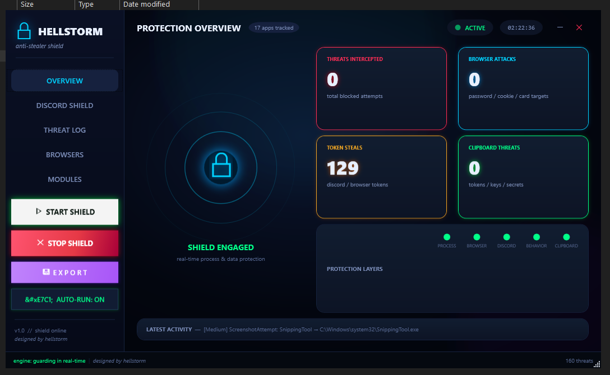
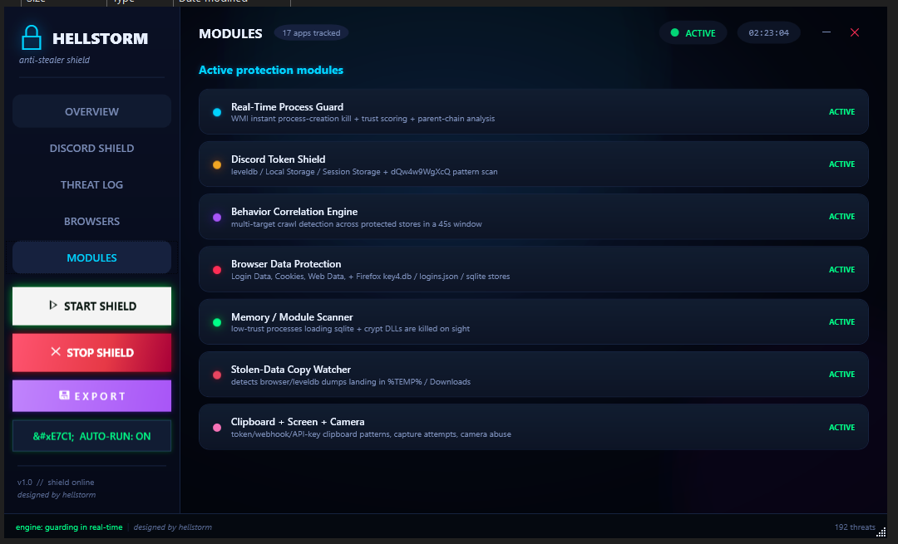

<div align="center">

# HellStorm — StopStealer

**Real-time token-grabber & infostealer blocker for Windows.**

Watches browser and Discord profiles, scans running processes down to raw
memory, and stops grabbers before they can phone home with your tokens.



</div>

---

## Why

Discord and browser token grabbers are usually tiny scripts or one-shot
executables that only *read* files — they never write, so classic file watchers
miss them. StopStealer blocks them with independent layers:

| Layer | What it catches |
|-------|-----------------|
| **Memory signature scan** | Token dump prefixes, webhook URLs, `CryptUnprotectData` / `os_crypt` calls, `users/@me` probes — in plain text **or** UTF-16, live in process memory. |
| **Behavioral + WMI guard** | New suspicious processes, script interpreters running from temp/downloads, HWID harvesting (`wmic csproduct get uuid`), DPAPI use by low-trust processes. |
| **Browser / Discord profile monitor** | File-system events on LevelDB, Local State and cookie stores, with the accessor attributed before any action. |
| **Camera / screen / clipboard guards** | Detects capture attempts by untrusted processes. |

Every block is live: process kill + quarantine, plus an entry in the app's
Threat Log tab. All logs stay on the machine.

## Screenshots




## Features

- Start / stop protection from the dashboard.
- Live counters: threats blocked, token grabbers, webhooks, crypto decrypt
  attempts, token steals prevented.
- Windows service for protection that survives logoff, plus a tray/WPF
  dashboard.
- Auto-start shortcut installed into the current user's Startup folder.
- Dark WPF UI with CPU/RAM gauges, recent-threat feed and per-layer status.

## Requirements

- Windows 10/11, 64-bit
- [.NET 8 SDK](https://dotnet.microsoft.com/download/dotnet/8.0) to build
  (.NET 8 Desktop Runtime to run a published build)
- Administrator rights **only for the service install**; the GUI itself runs
  as a normal user

## Build from source

```powershell
dotnet restore StopStealer.sln
dotnet build   StopStealer.sln -c Release
```

Outputs:

```text
StopStealer.Core\bin\Release\net8.0-windows\
StopStealer.GUI\bin\Release\net8.0-windows\StopStealer.GUI.exe
StopStealer.Service\bin\Release\net8.0-windows\StopStealer.Service.exe
```

> The repository also contains previously built `bin\` / `obj\` outputs. They
> are build artifacts, not signed releases; rebuild locally if you want to be
> sure what you are running.

## Install as a service

`StopStealer.Installer\Install.ps1` builds (optional), copies the binaries to
`%LOCALAPPDATA%\StopStealer`, registers the Windows service
`StopStealerProtection`, starts it, and adds a Startup shortcut for the GUI.

```powershell
# Run in an elevated PowerShell from the repository root
powershell -ExecutionPolicy Bypass -File .\StopStealer.Installer\Install.ps1 -Build

# Later, without rebuilding
powershell -ExecutionPolicy Bypass -File .\StopStealer.Installer\Install.ps1
```

Uninstall:

```powershell
powershell -ExecutionPolicy Bypass -File .\StopStealer.Installer\Install.ps1 -Uninstall
```

Notes:

- The installer must run elevated because it creates a Windows service.
- The install directory is under the **elevated account's** `%LOCALAPPDATA%`.
  On a shared machine, install from the account that will run the service.
- No code-signing certificate is shipped in this repository, and there is no
  signature-check launcher. Build, scan and sign the binaries yourself if you
  distribute them.

## Source layout

```text
StopStealer.sln
StopStealer.Core/        engine: memory scanner, process guard, browser and
                         Discord protector, behavior engine, logging
StopStealer.GUI/         WPF dashboard (this is the main UI)
StopStealer.Service/     Windows service host for the protection engine
StopStealer.Installer/   Install.ps1 (build / install / uninstall)
screenshot.png           dashboard screenshots
```

## Scope & safety

StopStealer is a **defensive** tool. Use it on machines you own or are
authorized to protect. It installs no kernel driver, phones home to no server,
and keeps logs local. It is not an antivirus replacement: a determined stealer
can evade user-mode hooks, so keep Windows Defender and OS updates enabled as
well. Distributed as-is, for security research and self-defense.

## Credits

Designed, engineered and polished by **GOLEM** / Team HellStorm.

## License

MIT — see [LICENSE](LICENSE).
